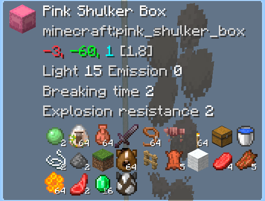
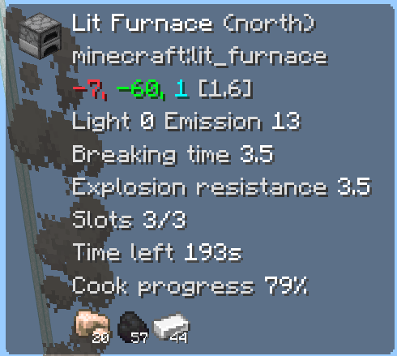
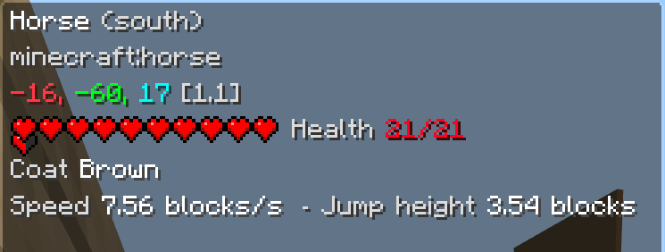
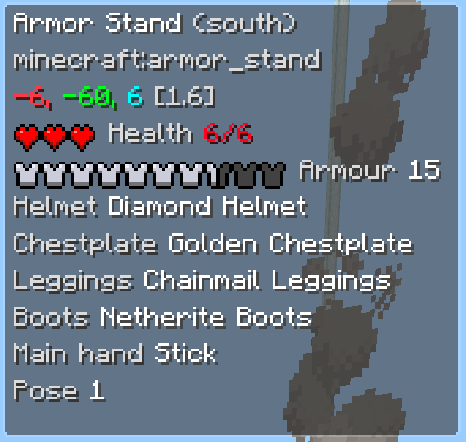
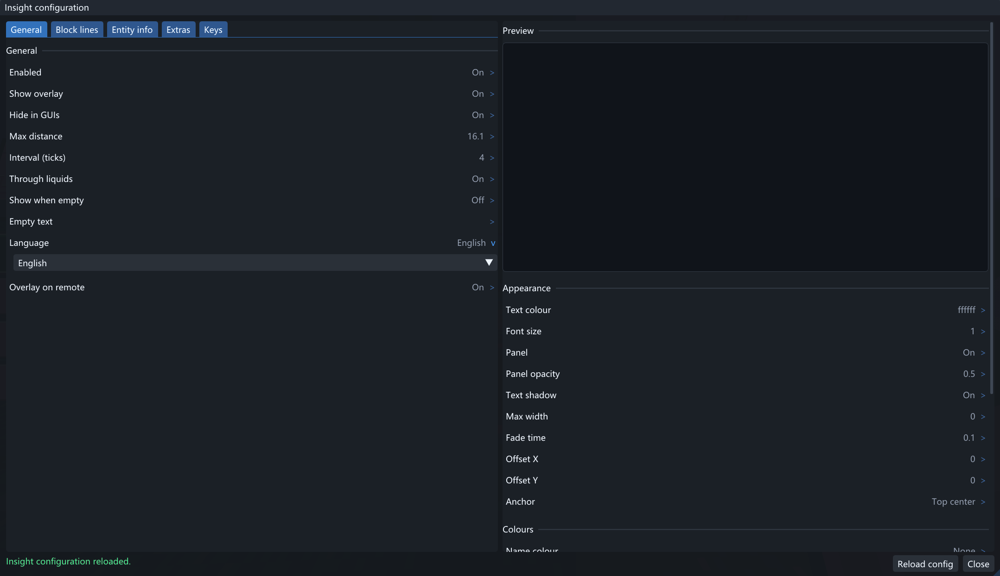

[](README.zh.md)


**Insight** is an info display mod for Minecraft Bedrock Edition (LeviLamina 26.51.\*)

| Shulker box | Furnace | Horse | Armour stand | ... |
| --- | --- | --- | --- | --- |
|  |  |  |  | and more to find |

On the client the panel is drawn by the mod itself; on a server it is shown in the action bar.

Every option can be changed in game.




- **Blocks and block entities**: name, type ID, translation key, coordinates, distance, facing, light level, plus the extra lines
- **Entities**: name, type, coordinates, hit points and armour (bar / hearts / numbers), owner, status effects, breeding and conversion timers, pet armour, horse and llama numbers, armour stand poses.
- **Containers**: chests, barrels, shulker boxes, hoppers, crafters, decorated pots, chest minecarts and furnaces all show the items inside. Like items can be merged into one entry
- **Furnace**: time left and cook progress

## Requirements

- Windows 10 or newer
- Install [LeviLauncher](https://github.com/LiteLDev/LeviLauncher)

## Installation

```bash
lip install github.com/neverforward/Insight          # server (BDS)
lip install github.com/neverforward/Insight#client   # client (GDK / LeviLamina client)
```

The first start writes the configuration file - `plugins/Insight/config/config.json` on a server,
`mods/Insight/config/config.json` on a client - with every default value.

## Usage

- `/insight gui` opens the configuration (on the client, `/cliinsight gui` or the hotkey, default <kbd>I</kbd>)
- `/insight set <option> <value>` changes a setting
- `/insight reload` re-reads the configuration (operator only)
- `/insight toggle` shows or hides the panel (on the client the same command is `/cliinsight toggle`; the hotkey, default <kbd>K</kbd>, toggles it too)

## Documentation

| Document | Contents |
| --- | --- |
| [docs/commands.md](docs/commands.md) | the commands |
| [docs/configuration.md](docs/configuration.md) | the configuration |
| [docs/building.md](docs/building.md) | building both sides, and the project layout |
| [CONTRIBUTING.md](CONTRIBUTING.md) | how to contribute |
| [CODE_OF_CONDUCT.md](CODE_OF_CONDUCT.md) | the rules for taking part |
| [CHANGELOG.md](CHANGELOG.md) | what changed in each release |

## License

MIT © neverforward
