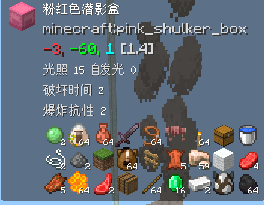
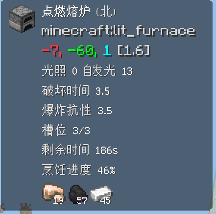
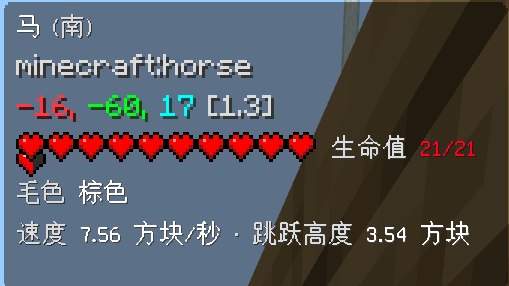
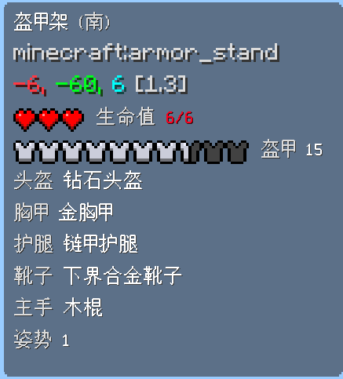
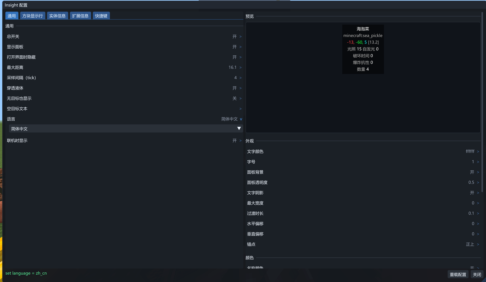

[](README.md)


**Insight** 是 Minecraft 基岩版（LeviLamina 26.51.\*）的信息显示模组

|潜隐盒| 熔炉 | 马 | 盔甲架 |...|
| --- | --- | --- | --- | --- |
||  |  |  |更多内容待你发掘|

客户端上面板由模组自己绘制，服务端上在action bar中显示

所有选项都能在游戏里改




- **方块与方块实体**：名称、类型 ID、翻译键、坐标、距离、朝向、光照，以及附加信息
- **实体**：名称、类型、坐标、血量与盔甲（条形 / 心形 / 数值）、主人、状态效果、繁殖与转化倒计时、宠物盔甲、马与羊驼数值、盔甲架姿势。
- **容器**：箱子、木桶、潜影盒、漏斗、合成器、陶罐、箱子矿车、熔炉 都会把里面的物品显示出来。同类物品可以合并成一个显示
- **熔炉**：剩余时间 与 烹饪进度

## 环境要求

- 系统版本Windows 10以上
- 安装 [LeviLauncher](https://github.com/LiteLDev/LeviLauncher)

## 安装

```bash
lip install github.com/neverforward/Insight          # 服务端（BDS）
lip install github.com/neverforward/Insight#client   # 客户端（GDK / LeviLamina 客户端）
```

第一次启动会生成配置文件，服务端在 `plugins/Insight/config/config.json`，客户端在 `mods/Insight/config/config.json`，里面是全部默认值。

## 使用

- `/insight gui` 打开配置（客户端用 `/cliinsight gui` 或快捷键，默认 <kbd>I</kbd>）
- `/insight set <选项> <值>` 更改配置
- `/insight reload` 重新读取配置（需要 OP）
- `/insight toggle`显示或隐藏面板（客户端用`/cliinsight toggle`可以使用快捷键，默认<kbd>k</kbd>）

## 文档

| 文件 | 内容 |
| --- | --- |
| [docs/commands.zh.md](docs/commands.zh.md) | 指令相关 |
| [docs/configuration.zh.md](docs/configuration.zh.md) | 配置说明 |
| [docs/building.zh.md](docs/building.zh.md) | 构建方法与项目结构 |
| [CONTRIBUTING.md](CONTRIBUTING.md) | 如何贡献 |
| [CODE_OF_CONDUCT.md](CODE_OF_CONDUCT.md) | 参与本项目的行为准则 |
| [CHANGELOG.md](CHANGELOG.md) | 更新日志 |

## 许可证

MIT © neverforward
